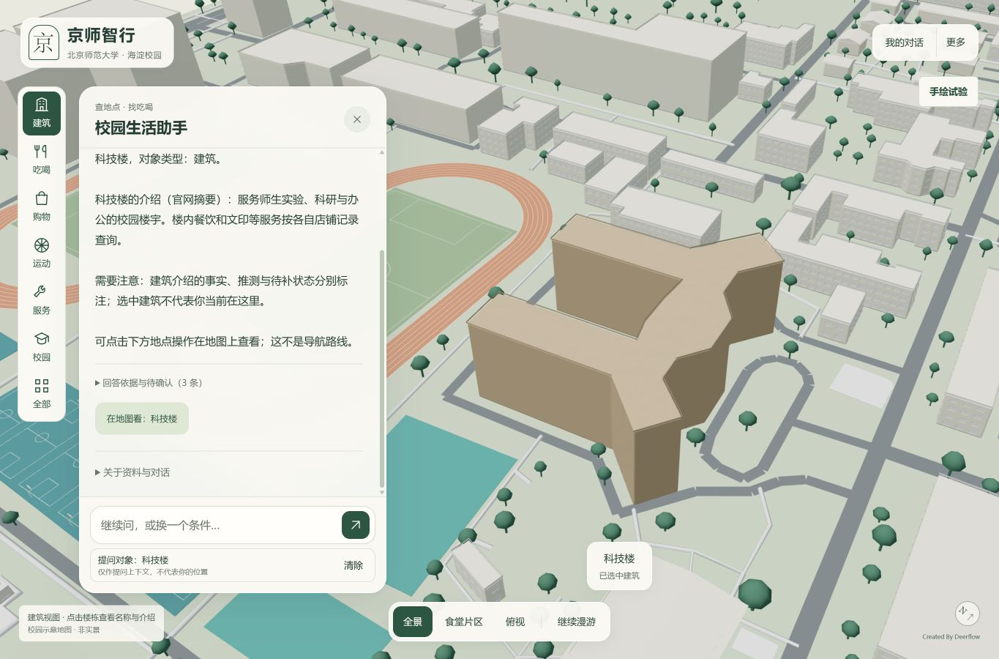
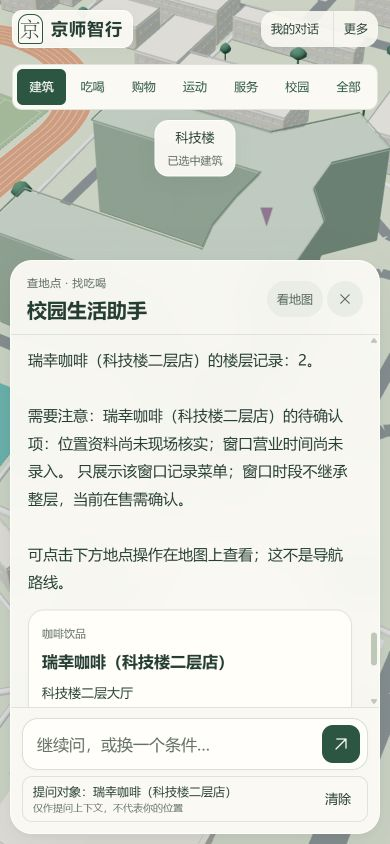

# 1.20.0-agent.1：证据回答与地图上下文

日期：2026-10-08。状态：第一轮实现与隔离验证完成；真实模型验收待进行。

本轮是既有 Agent 的增量改进，不是重新搭建多智能体框架。源目录、三维几何、SQLite、账号存储 schema、密钥及现有运行服务保持不动。没有迁移聊天、开启公网或推送 GitHub。

## 1. 本次解决什么

此前关系工具已经能查链条，但终端回答没有完整交付这些对象和依据；楼层餐饮卡也不足以表达独立窗口。本轮把链条接通：

```text
地图选中 / 当前问题
  → context.py：校验类型与ID，并重新查询真实对象
  → controller.py：有界工具循环，冻结本轮数据快照
  → tools.py：查建筑/窗口/POI、关系、菜单与条件候选
  → evidence.py：事实ID、未知项与受限回答编排
  → agent-answer.v2：文字＋卡片＋完整有界关系＋证据＋定位动作
  → explore：可清除提问对象，查看依据，点击后定位
```

本轮没有接真实预约、支付、实时路网和自动爬取，也没有重新设计美术。

## 2. 模块职责与可调位置

| 模块 | 职责 | 调整时重点检查 |
| --- | --- | --- |
| `backend/agent/context.py` | 类型化引用、重新解析对象、历史卡片引用 | ID与名称分离，选中不等于当前位置 |
| `backend/agent/tools.py` | 工具 schema、窗口菜单、楼内范围查询 | 菜单先按窗口筛选再分页，未知时段不继承父级 |
| `backend/agent/candidates.py` | 原推荐硬过滤与排序，支持候选POI范围 | 先过滤再排名，不自动扩大范围 |
| `backend/agent/controller.py` | 本轮快照、次数/时间预算、工具结果聚合 | 最新推荐条件废止旧证据，取消与错误可见 |
| `backend/agent/evidence.py` | 公开证据、回答计划、未知项保留 | 不能凭一个引用放行任意模型散文 |
| `backend/agent/prompts.py` | 模型职责与工具使用约定 | 提示不是授权，事实来自工具 |
| `backend/accounts.py` | 当前账号历史重建与请求幂等 | 不接受客户端指定他人历史 |
| `app/explore/agent-context.js` | 客户端引用、证据与定位动作验证 | 不接受任意坐标或可执行动作 |
| `app/explore/main.js` | 选中提示、关系/证据展示、账号模式联动 | 只在用户点击后移动镜头 |

原有模型适配器继续使用，不引入新的 SDK 或全局依赖。现有调用上限与阶段事件仍保留；NDJSON 状态事件不是逐 token 模型输出。

## 3. 新增请求与响应约定

请求增量字段（示意）：

```json
{
  "message": "这里有哪些窗口？",
  "context": {"selected": {"kind": "building", "id": "已加载建筑ID"}},
  "previous_entities": [{"kind": "outlet", "id": "已查询窗口ID"}]
}
```

- `kind` 仅支持 `poi`、`building`、`outlet`；客户端不提供事实名称、坐标和私有资料。
- `selected: null` 表示没有明确选择。失效选择被清除并提示，不猜同名实体。
- 匿名模式允许前端传有限引用；账号模式忽略客户端历史/旧引用，服务端从本账号上次成功结果恢复。
- 地图选择只是“提问对象”。计算步行仍须显式当前位置，不能自动认为人站在选中的楼旁。

响应保留旧字段 `answer/cards/conditions`，新增 `contract_version: agent-answer.v2`、`relations`、`entities`、`evidence`、`limitations`、`map_actions`、`context`、`scope`、`answer_mode`、`used_evidence_ids`。

关系不是只有POI卡片：楼层与窗口等非POI对象、路径中的边、依据状态、来源与查询限制均保留。一次响应仍有界：最多4份关系结果、24个聚合实体、120条可选证据和12个定位动作，不代表全校园完整导出。

新增 `get_entity(kind, entity_id, offset)`：建筑查介绍，POI查地点，窗口查自身菜单。窗口卡 ID 使用窗口 ID，`poi_id` 单独指向父级，避免同层多窗口互相覆盖。窗口菜单先过滤归属，再分页。

`recommend_food` 新增临时 `within: {kind: building|poi, id}`，只在用户明确要求限定范围时使用。范围过滤发生在排序之前；没有候选不静默扩大到其他楼。范围是本次工具参数，不改变原用户偏好存储结构；后续问题需根据对话再次显式传入。

## 4. 为什么采用受限回答

模型最终输出的是一个小计划，而不是直接显示给用户的任意事实文本：

```json
{"style":"guide","evidence_ids":["e-已查询事实ID"],"follow_up":"locate"}
```

服务端只接受已有事实ID和有限枚举，渲染已查询事实句。伪造ID、多余事实字段、未知风格、非法JSON或过长计划都退回确定性事实摘要，不再产生一次付费“修复回答”调用。模拟数据带模拟标记，规格与价格保持商品自己的来源，关键未知项独立追加，不由模型选择性删除。

这是“模型选证据、程序组织事实”的第一版。它控制无依据事实进入答案的通道，但不证明底层记录绝对准确，也不保证问题总被模型正确理解。目前文本仍偏结构化，关系查询的限制说明较长；不是已经完成自由自然解释、通用闲聊或复杂任务规划。

同一轮预算变更会重建证据集合，旧超预算菜品不能再用于新答案。推荐开始后，额外详情查询不混入新的未过滤候选事实；需要比较详情可在下一轮明确询问。这是本阶段的保守边界，不是完整多意图任务调度。

## 5. 账号与兼容性

- 沿用现有 `messages/cards/conditions` 和请求回执 `events` 容器，不迁移旧记录。当前账号上次成功回执可补充建筑、窗口引用；旧消息缺字段时从卡片恢复。
- `context` 纳入请求指纹；同一请求ID更换选中对象会被视为冲突，而不是错误复用另一对象的结果。
- 前端新增结构只存当前页面的 WeakMap，不批量重写旧历史。因此重新打开历史仍有原文字和卡片，但旧消息不保证恢复完整可折叠关系面板。
- 模型给出的地图动作必须对应本页已加载实体。窗口只能定位父级已知地点/楼栋，不声称定位到窗口门口。
- 旧 Python 服务尚不认识新 JS 模块时，只有明确404才回退旧功能并提示重启；网络/其他HTTP/模块错误显示加载失败。任何情况都不放松账号认证。

## 6. 验收与本轮纠错

2026-10-08 实际运行：

| 检查 | 结果与边界 |
| --- | --- |
| `python -X utf8 -m unittest discover -s tests -q` | 412项通过；隔离模型和测试数据 |
| `python -X utf8 -m unittest test_campus_api.py test_poi_import.py -q` | 9项通过 |
| `node --test tests/*.test.mjs` | 21项通过；包含13项新上下文前端场景 |
| `node tests/test_explore_interaction.cjs` | 29项隔离DOM场景通过，不等于WebGL或真实AI验收 |
| `node verify_web_syntax.cjs` 与 `node --check information/app.js` | 通过 |
| `git diff --check` | 通过；只提示既有LF/CRLF规范化 |
| 浏览器桌面1365×900 | 科技楼选择、资料回答、地图定位保留回答、楼内关系、窗口追问实测 |
| 浏览器窄屏390×844 | 输入框可见且发送可用，窗口提问对象可清除；本次控制台无error记录，不含真机软键盘验收 |

最后修正“对象位于自身”的冗余句式后，另复跑46项证据/上下文/账号回归与新JS语法检查，均通过。全量412项运行发生在该文字修正之前；不将局部复跑写成再次全量复跑。

浏览器运行 `python -m tests.run_agent_preview`，随机 loopback 端口、模型替身、无账号存储与密钥。回答从本地公开目录查询，提问带“隔离界面测试”；不是 DeepSeek 连通证明。实测截图：





本轮纠错：

1. 同楼层多窗口复用父ID会覆盖卡片——分别用窗口身份，父子ID独立保存。
2. 前端统一地点展示函数会把窗口名替换为父级名——窗口卡保留自身名称。
3. 预算降低后旧证据仍可能被选择——最新推荐重建事实集合，并加入反例测试。
4. 恶意或错误回答计划中风格字段可能是列表/字典——校验失败重置默认值，不让异常渗入渲染。
5. 私有路径过滤误伤 `https://`——修正边界并同时测试私人路径与公开URL。
6. 浏览器发现状态枚举直接露出、提示重复——本轮映射中文状态，去掉重复的通用结尾。
7. 新静态模块在旧内存服务返回404可能使整页中断——可选扩展明确兼容，不把鉴权错误静默绕开。

## 7. 生效与下一步

已有 Python 进程不会自动加载这些后端更改。未擅自停止持有密钥的服务；下次按原本机账号启动流程启动才加载新后端。没有创建或宣称新外网链接。

下一步先用真实模型验证约20条多轮脚本：建筑内发现、两个窗口比较、预算修改、指代与清除选择、无菜单/营业未知、模拟隔离与中断恢复，记录正确工具/正确实体/硬约束/耗时与费用。未做这一步前不声称真实语言理解达标。

之后再增加复合任务状态、官方文档检索和需确认的模拟预约。仍不以引入 LangGraph、RAG 或更多 Agent 的名称替代可复现行为改进。
