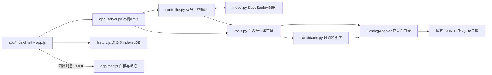

# 京师智行 1.5.0：生活助手测试版架构与验收

日期：2026-10-01。性质：本机试用，不是生产发布。现有采集/审核服务保持独立。

## 先看效果

打开 http://127.0.0.1:8793/ 。可以先在“发现店铺”打开学四食堂，展开菜单，再点“地图查看”。也可以展开“偏好与条件”，填预算20元、想吃辣、不吃米饭、当前位置教八、可用35分钟，点击“按这些条件找一找”。这是直接调用业务规则，不会假装调用了大模型。

自然语言入口已实现DeepSeek工具调用，但本轮真实请求被官方接口返回HTTP 401。不能据此宣称智能体已端到端接通。等待有效官方密钥，或用户明确提供第三方平台的Base URL与模型名；不得把同一密钥试发到猜测的供应商地址。界面区分“待验证”“鉴权失败”“已连接”。

## 1. 分层与职责



| 层 | 文件 | 只负责什么 | 常见调整位置 |
|---|---|---|---|
| 视觉 | app/app.css、responsive.css | 色彩、字体、间距、移动布局 | CSS变量与媒体查询 |
| 交互 | app/app.js、history.js | 表单、卡片、事件流、历史、错误提示 | 卡片组件和会话状态 |
| 三维 | app/map.js | white_v6加载、原XY表面射线、聚焦、高亮 | 相机、标记大小、交互；不更改业务坐标 |
| HTTP边界 | app_server.py | 同源检查、资源白名单、幂等、并发限制 | 路由与传输，不能存放业务推理 |
| 会话编排 | backend/agent/controller.py | 模型→工具→结果的有限循环 | 历史长度、补问和结束条件 |
| 提示约束 | backend/agent/prompts.py | 教模型选工具与增量修改条件 | 提示词；不放真实价格或菜单 |
| 模型 | backend/agent/model.py | 供应商请求、超时、规范化响应与错误 | 新增Qwen等适配器实现相同complete协议 |
| 工具 | backend/agent/tools.py | 查地点、菜单、课表，裁剪公开字段 | 增加一项业务能力，必须配套Schema和测试 |
| 推荐 | backend/agent/candidates.py | 硬条件、未知字段、估时、评分 | 推荐策略，不依赖供应商 |
| 配置 | backend/agent/config.json | 模型名、端点、权重、调用预算、时间参数 | 不含密钥；模型配置修改后重启 |
| 数据 | 既有backend/adapters.py | 基础目录叠加已发布审核数据 | 数据修订走原审核流程 |

现阶段没有安装LangGraph、smolagents，也没有引入向量库或训练模型。只读工具循环足够承载当前四项能力。对地图展示复用同一GLB与坐标契约；新旧地图交互代码目前仍是两个独立入口，未宣称已完成公共组件抽取。

## 2. 推荐不是让模型编菜单

模型仅解析需求并提出工具调用。服务端验证参数、查本地数据、做过滤和排序。卡片价格、地点、来源来自工具DTO，不从模型回答抽取。工具执行后的回复使用服务端模板；没查资料时不输出模型猜测的校园事实。

1. 默认真实资料，模拟由用户在界面主动选择；模型工具不能偷偷改变模式。
2. 排除历史/停业/范围待核、已停售、未知价格或超预算、明确忌口、无饮食安全依据的候选。
3. 正餐候选额外排除明确饮品甜点名称与配置中的茶饮品牌；这是保守规则启发式，不是已经补齐所有商品分类。源资料中蜜雪商品仍缺完整分类，不能按“默认dish”当成正餐；茶饮店的真实资料仍能查询。后续补齐商品类型后应替换这条保守规则。
4. 当前在售未知、实时排队未知、出餐未知等保留醒目提示。它们是“需确认候选”，不能宣称严格满足全部条件。原严格推荐接口不变。
5. 有完整时间数据才计算总用时。缺数据时只用已知部分计算下界：连下界也超时就排除；否则不能保证来得及。
6. 初始权重口味0.30、预算0.25、排队0.20、距离0.15、偏好0.10；仅已知评分项参与归一化。真实排队缺失时不使用模拟队列分数。
7. 最多返回三个不同Shop；楼层供餐集合不等于独立商户，保留原集合名称，不凭照片虚增窗口。

总时长：到店步行 + 排队 + 出餐 + 用餐 + 去课堂步行 + 缓冲。用餐15分钟、缓冲5分钟可独立配置。步行优先已有人工表，否则XY距离×绕行系数/速度；不是实际路径规划，更不是无障碍通行保证。

价格可能已变化；观察日期未知时明确提示。现实食材过敏安全不能靠“没写某食材”证明，因此饮食安全要求必须有专门依据。

## 3. API契约

| 方法与路径 | 行为 |
|---|---|
| GET /api/agent/status | 模型配置/连接状态、产品版本；不返回密钥 |
| GET /api/app/directory | 真实有效地点DTO与可选课堂位置 |
| GET /api/app/place?id=…&offset=0 | 营业资料与60条菜单分页 |
| GET /api/app/schedule?date=2026-10-01 | 虚构用户模拟课表 |
| POST /api/app/candidates | 条件筛选，不调用模型 |
| POST /api/agent/chat | NDJSON事件流：status、cards、result或error |

聊天请求示例（不含凭证）：

```json
{
  "request_id": "unique-request-uuid",
  "conversation_id": "browser-local-conversation-id",
  "message": "预算改成15元，其他不变",
  "mode": "real",
  "conditions": {"budget": 20, "avoid": ["米饭"], "current_location": "教八"},
  "history": [{"role": "user", "content": "20元以内想吃辣"}],
  "previous_poi_ids": []
}
```

条件增量合并：只改变本轮明确修改的字段，null清除字段、空数组清空列表。条件字段为budget、taste、avoid、likes、current_location、available_minutes、max_queue_minutes、next_class、exclude_poi_ids、dietary_requirements。next_class包含带时区time与已知location ID。

浏览器同源POST自动带Origin，另外要求`X-BNU-Client: 1`、JSON正文且不超过64KiB。Host仅允许本服务127.0.0.1端口。它不是公网身份系统，不可直接用隧道公开。

同request_id同正文可重放完成结果；正文变化返回409，处理中重试返回409。缓存只在进程内，最多100条，重启不保证跨进程幂等。最多两条同时进行的聊天，最多4轮模型、6次工具调用，整轮预算90秒；模型请求超时最多45秒。取消前端等待不能撤销供应商已处理的请求或保证不计费。

历史存在该浏览器该站点的IndexedDB。换浏览器/换端口不共享；清除浏览器数据会丢失。历史卡片标注生成时间，不是自动更新的实况。

## 4. 运行与改造

项目根目录运行：

```powershell
./start_local_app.ps1
# 无模型也能体验业务页面
./start_local_app.ps1 -WithoutModel
```

脚本在无进程环境密钥时隐藏询问，只在启动环境内传递给Python，退出恢复原环境。不修改.env、系统环境变量或任何密钥文件。未修改机器执行策略；若PowerShell阻止脚本，可在已有项目Python环境直接运行`python app_server.py --port 8793`，无密钥时保留资料功能。

改CSS/JS后刷新；改Python或模型配置后，核对8793所属进程，再停止对应应用并重新启动。不要按名字批量关闭Python，8792属于另一套团队审核服务。

切换Qwen等模型时实现`complete(messages, tools, deadline) -> (assistant_message, usage)`。消息应保留tool_call_id和工具结果；先测能否稳定输出工具参数，不能仅凭自我介绍判断能力。若服务API不是同一协议，添加适配器，不要在前端改后端业务规则。

这里的“微调”首先指界面、提示词、规则和配置调整，不是训练模型权重。训练微调应另行准备标注样本、固定测试集和成本评估。

## 5. 验收与限制

- 离线测试：新智能体43项；tests目录总计96项通过，另有原工作台/POI接口9项通过，共105项Python测试；差异填报7项JavaScript测试通过。覆盖候选过滤/未知值/模拟隔离、多轮合并、工具参数修复、调用上限、历史角色限制、菜单分页、HTTP私有文件隔离与幂等。
- 原规定语法检查与工作台/POI接口测试照常执行；不只跑新页面。
- 浏览器已查看真实学四菜单，点击卡片后94个模型内标记加载，学四所在建筑高亮；地图无控制台错误。
- 390×844手机视口验收：发现店铺、菜单从60条加载到120条、鉴权失败提示可见；随后恢复默认桌面视口。刷新后历史菜单仍在。桌面截图：`docs/app-preview-1.5.0.jpg`。
- 数据仍为308 POI、360条真实商品/规格、200条模拟商品，不能称全部店铺与菜单已完整、在售状态已更新。
- 学五截图时段补入既有正式JSON：06:30–09:00、10:30–13:30、16:30–21:00；保留截图哈希、旧状态备份及审计，拍摄日期和适用楼层仍未知。没有修改SQL表。
- DeepSeek官方接口真实测试：2026-10-01，HTTP 401，约3秒内失败，无成功响应usage；这不是推荐质量测试通过，不虚报准确率。
- 待有效模型凭证后：真实验证“20元吃辣→改成15元→不吃米饭→换一家”、新乐群四层菜单、模拟课表以及模型不可用回退。之后再采集人类选择反馈。

## 6. 参考与判断

[DeepSeek官方模型文档](https://api-docs.deepseek.com/quick_start/pricing/)在本次查阅时指定`deepseek-flash`，当前版本对应V4.1-Flash；调用方式按[官方工具调用文档](https://api-docs.deepseek.com/guides/tool_calls/)实现。模型名不是凭印象猜测。

[LangGraph](https://docs.langchain.com/oss/python/langgraph/overview)提供长期有状态编排、人工干预和恢复能力。本项目当前只读短任务，先保留编排层接口；以后确有长流程和审批时再评估引入。

[smolagents](https://github.com/huggingface/smolagents)可作为轻量模型/工具分离的参考。本轮不执行模型生成的任意代码，不给智能体文件系统写入、命令行、审核或付款工具。

这些是工程借鉴，不是算法创新证明。项目可体现校园课间约束、实地证据和三维联动的特点，但尚无与其他系统的对照实验，不能写“显著优于美小团”。

## 7. 本次纠错与防重复

- 用户要求明确架构：先列职责和可调入口，再实现；业务规则不藏进聊天提示词或界面。
- 曾出现POI悬空：沿原XY射线落模型，不统一加高，不把标记高度解释为商户楼层。
- 联调发现服务方法名`headers`与Python基类属性冲突：改为`response_headers`，保留真实HTTP回归，不以编译通过替代启动测试。
- 低价咖啡进入正餐候选：加入正餐资格过滤并测试，后续补真实商品分类时替换启发式。
- 未知位置候选不一定进入Top3：测试数据需隔离“数据保留”和“排名入选”，不能把没入选误判为被删除。
- 密钥“已填入”不等于“已连通”：必须检查真实返回状态，失败不伪装为模拟模型成功。
- 大菜单不能只截取前60条：模型每次取60条控制上下文，用户菜单提供后续分页。
