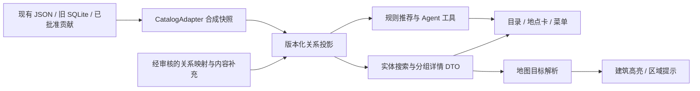

# 1.20.0 关系读模型与接口契约（设计草案）

日期：2026-10-08。本文保留总体设计草案；后续数据阶段已实现，当前字段、接口及差异见[data-1.20.0-stage.md](data-1.20.0-stage.md)。旧例子仍是设计示意，不代表完整方案已上线；持久化schema未改。

总方案：[upgrade-1.20.0-proposal.md](upgrade-1.20.0-proposal.md)。现状证据：[audit-1.20.0-data.md](audit-1.20.0-data.md)。

## 1. 边界与数据流

目标不是换数据库，而是确保“这道菜属于哪个窗口、窗口属于哪层、地图能定位到什么精度”在全链路保持一致。



- 保留原 POI、Shop、Item ID、旧 SQLite 表结构与审核历史。
- 不从浏览器直接读取私有目录；公共 DTO 白名单剔除本地路径、采集人、未公开照片、账号信息。
- 新版映射先候选审查，正式应用是独立动作；不因为设计了字段就自动迁移数据。
- JSON 关系投影足以支撑当前规模；此版不引入图数据库、向量库或多 Agent 编排框架。

## 2. 实体身份与关系

| 实体 | 一条代表什么 | 身份规则 |
|---|---|---|
| area | 校园片区或有依据的商铺分组 | 边界未知可只有名称/成员；不生成假边界 |
| building | 物理建筑 | 建筑 ID 与模型 mesh ID 分开，一楼可多网格；连接体需审核 |
| venue | 运营场所，如某楼层食堂 | 沿用现有 canteen-3、canteen-4 等入口的映射，不改原 ID |
| outlet | 有身份依据的店铺/窗口 | 已有 Shop 映射；同品牌不同分店不可合并 |
| menu_group | 同来源/菜单版面归类 | 不等于已核实商户；不能贡献“真实窗口数量” |
| item | 一条可辨识商品记录 | 保留 Item ID；同菜名不同窗口/规格不自动合并 |
| price_observation | 某规格、渠道、单位、时点的价格 | 不以百度人均消费填单价；称重价保留单位 |

新投影对象使用带类型的 `entity_ref={kind,id}`。现有 ID 不加版本后缀；新增分组 ID 从一次分配的稳定注册表取得，不用可变店名、数组位置或当前照片文件名直接生成。注册表属于未来私有关系映射的一部分，创建/发布前纳入实施确认。

统一命名：`outlet_ref={kind:"outlet",id:既有ShopID或新增稳定ID}`；简称 `outlet_id` 即该引用的 id。`exclude_outlet_ids` 仅接收这个命名空间，不接受 POI/menu_group ID，服务端必须校验类型。

照片补充、菜单更名不能换 ID。组的合并/拆分记录 `supersedes` 与历史映射；一对多拆分不重定向到随机子组。旧书签显示“分组已调整”并列出可选目标。

### 2.1 三类关系不得互相替代

| 类型 | 示例 | 约束 |
|---|---|---|
| 包含 | 淮南牛肉汤 → 新乐群四层 → 新乐群 | 直接父级唯一或明确待核；只检查包含边的无环性 |
| 参照 | 西侧商铺组 → 西北风味餐厅西侧 | 不进入父级面包屑、不继承该餐厅楼层/营业时间 |
| 顺序 | 小吃街主排各店从北向南 | 顺序只在同一序列内；不能推出间距、坐标或左右朝向 |

`offers` 连接窗口与商品；未证实归属的商品只 `listed_in` 菜单组，不能虚构 `offers`。名称别名用于搜索，不把两个同名分店认定同店。

### 2.2 事实、审核与营业状态分开

每个字段或关系分别保留：

- `origin`：official / field_observation / photo_transcription / user_confirmation / inferred / simulated。
- `review_state`：confirmed / candidate / disputed / unknown。confirmed 表示本项目审核，不等于学校官方背书。
- `evidence_refs`：证据 ID；公开只返回安全摘要和允许公开的 URL。
- `observed_at`、`retrieved_at`、`valid_from/valid_to`：不知道就 null，不用获取时间冒充观察时间。
- `operational_status`：营业、停用、历史等独立维度；“今天没开门”不直接设永久停业。

推测与创作可以丰富演示，但必须沿接口到 UI/Agent 保留标记；营业、价格、门禁、预约不因同一实体其他字段已确认而自动确认。不用虚构数值置信度伪装证据强弱。

## 3. 新三 / 新四：先分组，再确认窗口

只读审计基线：三层 98 条；四层 248 条楼层集合 + 6 条已有淮南窗口，共 254 条。共 346 条尚未逐一证实独立窗口归属。

建议处理顺序：

1. 先按现有 `menu_section` 和证据版面构成菜单组，使全部条目可浏览。
2. 逐个确认名称与边界；店招证据充分的组才映射为 outlet，保留全部原 Item ID。
3. 多张照片属同窗口时建立一个稳定组，照片作为多条证据；一张照片含邻店时划分证据区域，不能按照片整体归属。
4. 未确认组显示“窗口待核”；没有组线索的条目保留“本层待归属”。
5. 已独立的淮南牛肉汤保留独立身份和四层关联，不能重新并进楼层集合。

### 优先人工核对的证据

| 照片编号 | 已知线索 | 不允许自动推断 |
|---|---|---|
| 471 | 饮品甜点 116 条 | 不能据品类创造品牌或确认单一商户 |
| 472 | 水饺与小谷姐姐邻屏 | 26 条水饺不能全部挂到小谷姐姐 |
| 473 / 474 | 拌粉、吊龙米线 | 不能在未确认时合为一家 |
| 475 | 称重餐线索，当前无条目 | 不创造固定套餐价 |
| 487 | 鸡柳/汉堡套餐 | 身份不清前保留菜单组 |

上述 5 张已转录照片涉及 175 条，另 475 无条目。462 的“6号重庆手撕鸡饭”、477/478 的“朱家小馆”可优先做候选归属，但仍输出 diff 供审核，不能仅凭本次方案自动改库。

计数必须分别报告 `outlet_count`、`unverified_group_count`、`item_count`。示意菜单和真实转录的计数不可混报。

## 4. 面向页面的契约

### 4.1 三种 ID 各负其责

搜索命中 → 打开实体，用 `entity_ref`；排除同一家，用 `outlet_id`；地图高亮，用 `map_target`。不可把新窗口/组 ID 塞进旧 `poi_id` 参数。

当前 `showPlace` 依赖旧 POI 行，不能直接消费新组 ID；实现时新增统一 `openEntity(ref)`，兼容 `openPlace(poi_id)`。

以下例子全为契约示意，`example-*` 不是真实记录；null 明确表示未知：

```json
{
  "contract_version": "1.20-draft",
  "snapshot_id": "example-snapshot-001",
  "entity_ref": {"kind": "menu_group", "id": "example-group-001"},
  "name": "菜单分组 · 窗口待核",
  "breadcrumbs": [
    {"ref": {"kind": "venue", "id": "canteen-4"}, "name": "新乐群四层"}
  ],
  "outlet_ref": null,
  "identity_state": "candidate",
  "map_target": {
    "kind": "building_anchor",
    "poi_id": "canteen-4",
    "precision": "building",
    "can_measure_to_entrance": false
  },
  "capabilities": {"menu": true, "reservation": false},
  "item_count": 2,
  "items": [
    {"id": "example-item-001", "group_id": "example-group-001", "shop_id": null,
     "name": "示例菜品", "price": null, "price_unit": null,
     "origin": "simulated", "review_state": "unknown"}
  ],
  "loaded_count": 1,
  "next_cursor": "example-opaque-cursor",
  "notices": ["此为设计样例，不是实际菜单"]
}
```

源数据保留原 `shop_id`；新 DTO 的 `shop_id` 只指已确认的窗口/商户，无此身份时为 null。原楼层集合父 ID 在投影内部保存为 `legacy_parent_shop_id`，不重新冒充真实商户；这不授权清空源字段。若物理建筑关联未知，面包屑从已确认楼层/片区起，不编造父节点。

### 4.2 拟议读接口（实施时再落地）

沿用现有服务，建议新公共应用契约集中为 `/api/app/v2/`，与旧 `/api/app/place?id=...&offset=...` 并存；既有 `/api/life/` 业务能力不重命名。不启动新服务、不修改身份模型；实施时审查本机/公网预览各自的路由白名单，不能为新接口放开整个私有数据目录。

| 接口提案 | 输入 | 输出 / 规则 |
|---|---|---|
| GET /api/app/v2/entities/search | q、kind、area、cursor、snapshot_id | 带类型命中、匹配字段、面包屑、地图目标；别名不重复造实体 |
| GET /api/app/v2/entities/{kind}/{id} | snapshot_id | 实体摘要、能力、子级计数、来源摘要 |
| GET /api/app/v2/entities/{kind}/{id}/children | cursor、snapshot_id | 建筑内楼层 / 场所内窗口与待核组；保持稳定排序 |
| GET /api/app/v2/menu-groups/{id}/items | cursor、snapshot_id | 本组商品，不平铺整栋楼或整层；总数和加载数分开 |
| 现有 get_place / 旧 /pois | 原参数继续支持 | 保留旧字段；增补安全分组摘要，避免破坏旧页面 |

菜单首批建议 24 条，上限 60 条；按显式顺序再 ID 排序。搜索有总数与继续入口，不让原“只取前 8 条”隐藏其余命中。页大小是性能设计值，不是观测结果。

不要把全部菜单嵌套进一次楼栋详情：先目录、再打开组、最后取商品。公共设施没有 menu 能力时不返回空餐饮模块。

旧服务没加载新路由时，页面按 capability/version 明确回退或提示需重启，不能把 404 当“暂无菜单”。新聊天卡增加 `card_contract_version`；历史旧卡继续按旧 POI 语义回放，不迁移私人聊天。旧接口测试与新契约测试同时保留。

### 4.3 同一快照贯穿一次任务

`projection_version` 说明算法版本，`snapshot_id` 说明数据版本，二者不能混用。

- 快照构建于合并完成后；同一次用户请求内的全部 Agent 工具调用复用同一不可变快照，不在每次工具调用时重新合成。
- 指纹涵盖基础目录、百度标准化数据、旧SQLite已读取记录的规范化逻辑摘要、贡献的published子树、官方补充、关系映射、建筑目录与mesh映射、投影算法版本；不包含账号/草稿/令牌。无序键稳定序列化，不能仅看某个文件mtime或直接对整个数据库文件取哈希。
- 构建前后验证输入版本一致，发现并发发布则重试；不得把两次读取的不同版本拼成“新快照”。涉及发布锁/新快照文件的改造先审查现有写入器，不能偷偷改数据库。
- 后续分页游标绑定 snapshot、实体、筛选和最后排序键；参数变化不沿用旧游标。
- 旧快照不可用时返回 `SNAPSHOT_EXPIRED`，页面提示“资料已更新，重新载入”，不悄悄接上新版本页面。
- 草案建议缓存当前和上一快照，设体量上限，具体数量经测量；账号和聊天不包含在这些公共快照中。

## 5. 地理契约：在哪里与画在哪里

| 可用信息 | 地图动作 | 距离 / 推荐约束 |
|---|---|---|
| 已核实入口/位置 | 标点并高亮对应楼栋（若有关联） | 可按来源精度估算；仍不是室内导航 |
| 可靠楼栋关联 | 倒三角落到楼栋表面，展开楼内目录 | 只作楼栋尺度估算，显示“到楼栋附近”；不能承诺到窗口时间 |
| 只有区域/参照 | 打开区域清单，镜头看参照范围 | 不返回伪精确店门距离、ETA |
| 完全未知 | 列表/搜索可达，禁用精确定位并解释 | 时间硬约束候选标不确定或排除 |
| 创作示意点 | 独立示意样式 | 不参与真实测距与准时承诺 |

模型坐标沿用现有投影与原点；不在前端重新转换一套坐标。楼层是属性，不等于得到精确室内三维点。默认倒三角表示建筑 XY 锚点，不让所有 POI 飘在空中。

西侧 5 家商户可先建立“同楼组（模型待匹配）”，共同引用参照关系，但不挂到西北风味餐厅楼内。小吃街 13 店主排的顺序不与南二层/天猫校园等其他组连成一根线。

地图目标中的 `building_anchor` 指所在楼栋；`reference_area` 指附近/西侧参照范围。两者不可共用含糊的“建筑参照”类型，避免客户端再次混淆包含与相对位置。

## 6. 推荐与 Agent 的改造范围

- 模型负责理解意图、选择只读工具、解释结构化结果；身份归属、过滤、排序、价格/时间判断仍由确定性代码处理。
- 新增 typed entity 工具或为现有工具增加兼容版本；禁止模型自行拼造实体 ID、精确坐标、楼层和价格。
- `exclude_outlet_ids` 处理“换个窗口”；保留 `exclude_poi_ids` 处理“整家场所都不要”。含义不同，不自动把 outlet 换成整层 POI。
- 已核实窗口按 outlet 去重。身份不明的组可浏览，但严格“3 家不同商户”推荐不将多个待核组视为已知不同店；必要时保守按原集合去重，并返回不足原因。
- 未知价格、称重价、未知出餐/排队/室内步行不能断言符合硬预算/上课时限；可给“待确认备选”，与已满足条件候选分栏。
- 模拟模式和真实模式的 group/item 不能混用；店名真实不等于菜单/等待时间真实。
- 来源标记由服务器生成，不依赖模型在自然语言中主动加免责声明。
- 真实模式使用明确的 `decision_eligible` 能力规则，不只排除 `source == simulated`：否则 inferred 也会被当真。对价格、时间、饮食限制逐项判定，任一关键断言不足则不能输出相应保证。
- 统一可见性策略：`browseable`、`historical_only`、`recommendable` 分开；停业窗口历史菜单可查，但不能混作现行候选。
- 组/商品独立表达 `category` 和 `meal_role`（正餐、饮品、小食、未知），不因父级是食堂就把所有甜点当午餐。无依据时保持未知。

## 7. 完整性与发布门槛

1. 原 560 Item ID 全量对账：保留、排除或修订有明确原因；不能以分组整理为由丢失记录。200 模拟与 360 非模拟的口径保持可追溯。
2. 38 条时间表逐条检查实体存在、别名、分类、区域、搜索、UI 入口、位置精度；38/38 可发现不等于 38/38 入口坐标已核实。
3. 新三/新四原数与各组数量守恒；淮南的 6 条不会既归集合又重复出现在独立窗口计数。
4. 公共 DTO 无私有证据路径或采集人；来源文件可由授权管理员查询，不靠前端隐藏保护。
5. 新 group ID 打开、窗口级“换一家”、跨发布分页一致性、推测进入真实推荐、历史菜单进入当前候选、饮品被默认作正餐六项为 P0。
6. 映射只有在审查通过后发布；测试使用隔离目录和少量匿名样例，不写真实账号/提交状态。

实施交付物：投影校验报告、旧新接口差异、38 条可发现矩阵、菜单归属 diff、待核照片清单。所有未确认的真实信息保持未确认；完整测试门槛见 [acceptance-1.20.0.md](acceptance-1.20.0.md)。
