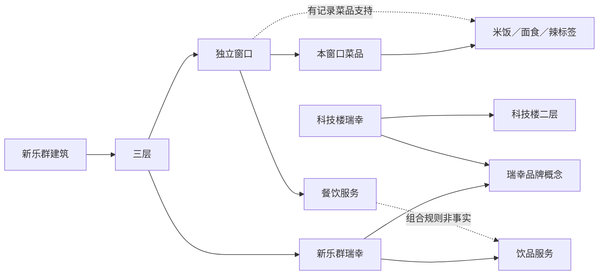

# 1.20.0-data.3：校园 POI 多维关系网络

本轮目标不是再画一棵目录树，而是让数据能回答：在哪里、和谁同类、与什么服务可以组合，以及每个结论凭什么成立。仍是数据阶段，UI、三维几何、账号、运行服务和原库未改。

## 1. 从树到网络

同一个节点可以参与多种关系。边的种类不能互换：同楼不等于同店、同品牌不等于相同菜单、相邻不等于存在通路、价格有记录不等于现在在售。



图中包含箭头是面向阅读的上到下画法；机器契约的 `contained_in` 方向是子对象指向父对象。虚线不是测绘路线。

## 2. 关系字典

| 维度 | 机器关系 | 实际用途 | 不能据此断言 |
|---|---|---|---|
| 身份 | `same_as` | 旧 ID 追溯到规范身份 | 同名、同品牌自动合并 |
| 包含 | `contained_in`、`listed_in`、`offered_by` | 建筑、楼层、窗口、商品归属 | 共楼就共菜单或共营业时间 |
| 楼内空间 | `in_building`、`on_floor`、`located_in_part` | 找同楼同层、北面或西南侧 | 入口位置、室内连通、楼梯可用 |
| 定性位置 | `adjacent_to`、`west_of`、`east_of`、`relative_to` | 果荟/天猫、蜜雪/肯德基及参照关系 | 精确坐标或步行时间 |
| 街区次序 | `ordered_along`、`next_in_roster` | 按已有北到南名录查前后记录 | 连续店门、无漏店或无障碍通行 |
| 度量近邻 | `nearby_estimate` | 已有有效记录点的近邻发现 | 可达、顺路、入口间真实距离 |
| 同类 | `has_category`、`provides_service` | 餐饮、饮品、零售、打印等服务比较 | 服务一定可用或两店完全可替代 |
| 品牌 | `of_brand` | 同品牌不同分店比较 | 所有权已核验、共享价格/库存 |
| 商品属性 | `has_trait` | 菜品原记录中的口味或主食标签 | 全成分、过敏原或安全保证 |
| 窗口属性 | `offers_trait` | 有真实菜品支持的“曾有米饭等选项” | 每道菜都有该属性、现在在售；缺标签不等于无该成分 |
| 跨类组合 | `service_complements` | 学习与打印、学习与饮品、用餐与饮品 | 任意两地点都近或能顺路去 |
| 来源与区域 | `derived_from`、`member_of`、`same_building_member` | 原集合溯源、街区成员和同楼组 | 区域逻辑分组就是测绘边界 |

类别、服务、品牌和标签是共享概念节点。例如6处瑞幸只需连接一个品牌节点，不用制造15对“同品牌”边。后续每新增一家只增加自己的归属边。

## 3. 证据约定

每条边有稳定 ID、带类型的起终点、规则版本、依据、限制和来源对象引用。

- `confirmed`：用户明确确认的关系；不扩大到其他字段。
- `recorded`：源记录已记载；不自动称为现场核实。
- `computed`：由坐标、包含路径、名录顺序或真实商品标签计算；保存支持边。
- `inferred`：守卫名称规则或功能组合推测；不是事实升级。

`data_mode` 再区分真实、模拟及推测来源，不能用边的 `recorded` 掩盖其来源是模拟。模拟/停用/范围外记录保留在完整导出中，普通网络查询默认排除；模拟中间楼层和区域也不得生成真实派生边。

未知时段仍为未知。20个已确认新窗口不能继承楼层的营业时间。跨类组合返回候选前必须同时存在直接邻近或同楼证据，查询结果仍需后续通过预算、时间、饮食等条件筛选。

## 4. 空间计算与截断

计算坐标采用现有模型的 `local EPSG:32650`，原点 `[445334.2137655129,4423619.17603345]`；x向东、y向北，单位米。没有引入新坐标系、移动点或改白模。

默认半径250米，每点取最近8个，再合并无向边；这些是探索参数，不是经用户实验验证的最优值。保留半径内候选总对数与被截断点数，没返回边不代表两点不近。

欧氏距离为 `sqrt((x2-x1)^2+(y2-y1)^2)`。距离不足15米时不报八方向，避免把近似点的小偏差包装成可靠东南西北。反向查看一条边时原起终点和方位含义不变。

楼栋中心、展示锚点、区域参照、点级 `precision=building`、错误投影、非有限值及果荟/天猫冲突点均不参与店铺距离计算。需要导航时应另外采集入口与可通行路网；不能把网络中的任意关系链当路线。

## 5. 已实现的查询方式

只读接口：

```text
GET /api/app/v2/network/summary
GET /api/app/v2/network/entities/poi/luckin?mode=same_type&limit=8
GET /api/app/v2/network/entities/poi/reported-174e0a7adb61c3ad?mode=complementary
GET /api/app/v2/network/entities/outlet/outlet-xinlequn-3-001?mode=chain
```

- `neighbors`：直接关系，优先明确空间依据。
- `same_type`：共享类别、服务、品牌或记录标签；同楼/同层只作辅助，不能单独冒充同类。
- `complementary`：语义互补且同时有空间依据；已知同店 POI/Shop 避免重复展示，独立窗口保留。
- `chain`：有界解释链，不通过全校区域或宽泛类别枢纽把大半目录串来；不是导航。

API每次最多30项；`total` 表示当前模式可发现的关联对象数，`truncated`明确提示截断，不是店铺总数或现实完整率。带 `snapshot_id` 可继续查询同一份保留快照，过期返回409。沿用既有Host与账号边界，不开放私有导出文件。

Agent新增 `get_related_places` 工具，最多12项，单轮固定目录、建筑与区域数据。工具输出经公开白名单裁剪，不包含原始照片路径。建筑、窗口与概念不伪装成POI卡；最终文字使用可核查模板，不放开模型编造校园事实。本轮没有调用付费模型或重启旧服务。

## 6. 实际探索与需要补的链

| 问题 | 已有关系 | 剩余缺口 |
|---|---|---|
| 科技楼瑞幸与新乐群瑞幸什么关系？ | 不同ID、不同楼层；共享品牌及饮品服务概念 | 分店菜单、部分营业时间；不能相互复制 |
| 西侧乡村基吃完能发现什么相关服务？ | 与西侧库迪同建筑；餐饮与饮品组合规则 | 入口、上下楼方式、当前供餐状态 |
| 蜜雪和肯德基是否关联？ | 人工确认相邻；饮品与餐饮互补 | 精确店门、可通行关系和实时排队 |
| 新三不同窗口能怎样比较？ | 各自独立身份、同层、菜单归属、部分真实主食/口味标签 | 其他标签、时段、实时在售，不能以名称猜菜系 |
| 优果荟与天猫怎么找？ | 相邻且果荟在西、天猫在东 | 共同点选绝对位置；冲突源点继续禁用 |
| 图书馆能否连接附近打印店？ | 图书馆建筑有学习用途；打印服务已有若干记录 | 当前没有满足直接邻近/同楼证据的组合结果；先补打印位置与图书馆入口 |
| 运动后去哪里补水？ | 已有体育场馆节点 | 饮水设施POI、瓶装水商品均无记录，只能列缺口，不造供应关系 |

营业资料审计：309 POI中62有结构化时段，另4条只有带“或／休息日／大假”等条件文本，243完全未知。这是POI口径，不等于各窗口都有营业时间。`walking_times`目前0条，导航上下文仅3个模型中心近似点。营业共同可用、步行可达、上下楼耗时因此尚未成为事实边。

补链优先级：①蜜雪/肯德基及果荟/天猫共同点选，②打印店、图书馆与食堂出入口，③新三/新四楼梯与窗口时段，④小吃街连续门面和支巷通行，⑤体育场馆与饮水点。每次采集记录日期、对象ID和字段证据，不要求重填已有默认值。

## 7. 代码与复算

| 文件 | 职责 |
|---|---|
| `backend/poi_semantics.py` | 分类、服务、品牌、真实商品标签 |
| `backend/poi_network.py` | 图装配、空间推导、支持链和完整性校验 |
| `backend/seeds/poi-network-policy.json` | 原点、阈值、互补规则及限制 |
| `backend/poi_network_query.py` | 公开只读查询、排序、截断和证据DTO |
| `backend/life_relations.py` | 把网络装入同一版本快照 |
| `backend/agent/tools.py` | 单轮冻结后按需读取网络 |
| `backend/catalog_exports.py` | 新run输出，不覆盖data.1/data.2 |

私有整理包包含 `network.json`、`network-edges.csv`、`network-issues.csv` 和 `network-examples.json`。`inspect.ipynb`重算节点/边唯一性、悬空引用、支持边存在性和关系计数；原560项商品ID仍检查守恒。

## 8. 本轮纠错与验收边界

用户指出先前只整理了包含关系，未完善POI之间的多维链条。修正方式是先定义可回答的问题和证据要求，再生成多层网络与查询工具，不用边数量代替信息价值。

独立复审发现并修正：点级楼栋锚点被误当记录坐标；模拟中间节点可能生成真实捷径；仅范围外记录可能残留可见概念。实际探索还发现全餐饮类别导致三跳扩散过多，以及同店POI/Shop重复，需要按关系用途限流和去重，不能只看图算法能返回结果。

最终计数、导出路径和验证结果记录在下方交付快照；旧服务尚未加载本轮Python代码。未更改UI、数据库schema、原始JSON或SQLite、三维几何、密钥与公网入口，未push。隔离工具测试不等于已通过真实模型或手机端实测。

## 9. 交付快照（2026-10-08）

原始数据仍为309 POI、296 Shop、560 Item（360真实来源、200模拟）。关系视图保留这批原ID，不往源库插入概念或新窗口。

| 网络口径 | 数量 | 解释 |
|---|---:|---|
| 节点 | 1,523 | 含建筑、楼层、商品、来源集合与概念，不是商户数 |
| 边 | 4,201 | 含来源和模拟结构边；不是4,201条经现场确认事实 |
| 边来源模式 | 3,961真实来源、240模拟来源 | 来源真实不代表关系已经实地核验 |
| 证据状态 | 2,718记录、392确认、1,008计算、83推测 | 人工确认与推导分开 |
| 概念 | 7类别、15服务、9品牌、3当前标签 | 是当前有依据实例的概念，不是穷尽校园所有服务 |
| 可参与当前网络查询的POI | 307 | 去掉停用/别名等，不等于307家店 |
| 可计算直线距离的记录点 | 218 | 入口未复测；其余75为楼栋/区域等锚点、14缺点 |
| 受限近邻边 | 818 | 半径内共1,124对，120个点发生前8邻居截断 |
| 同楼/同层捷径 | 95 / 40 | 由原包含链推导，保存支持边 |
| 名录下一条 | 31 | 只表示已有列表顺序，不保证中间无漏店 |
| 商品标签 / 窗口有此选项 | 147 / 24 | 有的商品多标签；不表示24个窗口或24道菜 |
| 分类差异提示 | 6条 | 对应3个地点及其Shop投影，不是6家新店 |

快照标识：`sha256:f679775d6f08822a57d79df05384cd1763e93b507c16613aebbc03efadf22c49`。完整网络保留历史和模拟记录，公开查询只读取符合条件部分，两个计数口径不可直接相减解释为缺店。

最终整理包：[data.3-r2 说明](../data/life/organized/data-1.20.0-data3-20261008-r2/README.md)，25文件约17.667 MiB，逐文件SHA-256与notebook顺序执行均通过。r1为结果排序、同店投影去重前的中间核对包，原位保留；两包源网络相同，查询实例不同，不覆盖历史。

实际抽查：科技楼瑞幸同类查询首项为新乐群三层瑞幸；蜜雪互补返回4个关联对象，肯德基仅一条；乡村基两至三跳链返回7个对象（含楼层，不能称7家店）；图书馆互补结果0，保留空间证据缺口。

最终验证：`python -X utf8 -m unittest discover -s tests -q` 为366项全部通过（75秒）；旧 `test_campus_api.py/test_poi_import.py` 9项通过；8个Node测试文件、网页语法检查、Python编译与diff空白检查通过。新增隔离用例覆盖点级锚点、错误坐标、模拟中间节点、类别扩散、同店简名/分店名重复、证据截断、快照保留、Host和账号边界。原5份核心源文件及15份探索前端文件的SHA-256未变。知识笔记按Obsidian规则更新并检查链接，未做Obsidian阅读视图验收。
