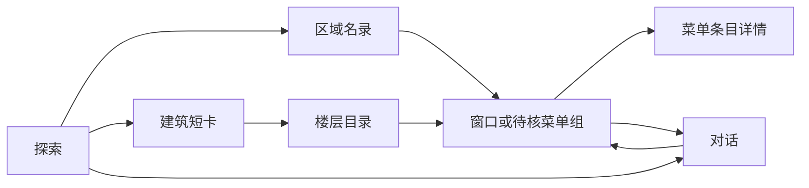

# 1.20.0 页面、镜头与美术设计规格

日期：2026-10-08。状态：**设计草案，尚未实现或完成新 UI 实测**。适用已有 Python + Three.js 应用，不另造静态假产品。

关联：[总方案](upgrade-1.20.0-proposal.md) · [数据契约](contract-1.20.0-relations.md) · [验收方案](acceptance-1.20.0.md)。

## 1. 用户应该感受到的改变

一句话方向：**一张能自由走近、看懂楼内生活的校园微缩地图。** 助手陪伴探索，但不占据首屏。

| 1.15 可见形态 / 风险 | 1.20 设计变化 | 用户价值 |
|---|---|---|
| 较高的常驻欢迎 / 对话卡 | 首屏无长空卡，只有一个搜索/询问入口 | 先看到校园，清楚自己在看哪里 |
| 楼栋、店铺近似统一详情 | 短建筑卡 → 楼层目录 → 窗口菜单 | 不再把一层食堂当一家店 |
| 侧边多个同权重分类块 | 一条紧凑分类系统，当前类别突出 | 操作少，类别仍可发现 |
| 点击详情返回总列表 | 显式导航栈，返回恢复上一层 | 不丢查询、滚动和回答上下文 |
| 固定镜头偏移 | 按真实面板遮挡构图 | 楼不躲在卡片后面 |
| 低对比绿灰模型与道路 | 暖灰建筑、深浅明确的道路、少量金色选中 | 场景更易读，颜色承担语义 |

设计验收必须同时出现布局、信息层级、镜头与材质变化；只换背景、圆角、阴影不算大版升级。

## 2. 参考证据与可借鉴范围

| 来源 | 已取得内容 | 本项目采用 | 不声称 / 不复制 |
|---|---|---|---|
| [Colonia Zacamil](https://coloniazacamil.com/) | 本地保存入口截图；2026-10-08 再次内部地图截图超时 | 场景优先、紧凑深色操作、明确视线中心；内部地图仅承接用户既往描述，待补视觉核验 | 未验证其实现细节/帧率，不复制纹理或建筑资产 |
| [Apple Maps](https://www.apple.com/maps/) | 本轮官方页面文本复核 | 地点资料分层、类别探索、地点上下文 | 没有实测原生 Maps；不照搬品牌、专有字体与地图 |
| [Earth Studio Camera Target](https://earth.google.com/studio/docs/advanced-features/camera-target/) | 本轮官方目标相机说明复核 | 围绕明确目标组织相机与连续过渡 | 不引入 Earth Studio 引擎，不宣称有真实路线导航 |
| 本项目 1.15 截图 | 本轮重新打开 desktop-final | 真实校园构图、已有颜色与功能作为基线 | 旧截图不算 1.20 成品或新一轮测试 |

本地参考：[Colonia 入口](design-1.20-ref-colonia-01-entry.jpg)、[1.15 页面](design-1.15-desktop-final.jpg)。原用户上传 Colonia 大图临时路径已失效；已询问是否先基于现存两图生成，不用文字假称附上失效图片。

## 3. 三个待比较的布局方向

这是布局策略，不是三个不同品牌。共用“暖纸、墨色、银杏金”的视觉语言、真实地图和同一数据契约；不引入无需求的排行榜、下单或支付。

### 漫游导览（优先建议）

- 首屏顶部居中为轻量搜索 / 询问框，下方一条紧凑分类；左下是当前片区名，底部是导览控制。
- 建筑点击弹出左侧短卡；打开窗口或提问时同一内容区扩展为工作面板。
- 地图始终占主要画面，复杂信息有稳定阅读区。适合竞赛视频，也兼顾菜单和长回答。
- 风险：顶部搜索框移到任务面板时必须保持同一个输入组件和焦点，不能复制两个可发送输入框。

### 场景手册

- 顶部只留紧凑导航与询问入口；内容集中在底部横向展开的浅色资料带。
- 选择楼栋、楼层、窗口在资料带内递进；大面积地图保持完整，适合展示连续镜头。
- 风险：桌面长菜单与对话需要展开阅读态；底部多列不得在手机变成横向溢出。

### 校园图鉴

- 左侧只留分类轨；右侧是与地图共享选中状态的窄目录 / 详情面板。
- 以“片区—建筑—楼内生活”的目录为主，询问入口仍在顶部；看完资料可一键收起。
- 风险：右侧长面板容易重新主导画面，必须保留短卡态；与当前版变化要体现在实体层级和首屏收纳，不仅换边。

概念图生成时三张采用**相同视口、相同校园角度、同一个查新乐群菜单任务**比较布局，不用一张全景、一张手机、一张特写制造不可比的“好看”。用户选定后再补手机 / 错误 / 长对话状态。

## 4. 明确页面状态，而不是堆浮窗



最后两条是“从回答打开资料 / 返回同一回答”，不是每次打开窗口都强制进入聊天。

| 状态 | 必须显示 | 主动作 | 不应出现 |
|---|---|---|---|
| 探索 | 校园场景、当前类别、唯一询问入口 | 搜索/提问或点楼 | 常驻欢迎大卡、整排营销口号 |
| 建筑短卡 | 楼名、简短用途、简介依据、楼内入口 | 看楼内场所 | 运动场馆“菜单0条” |
| 楼层目录 | 父建筑、楼层、窗口与待核组分别计数 | 打开一组 | 整层数百菜平铺、凭空室内平面图 |
| 窗口 / 菜单组 | 楼栋—楼层路径、身份状态、菜单、营业依据 | 查看菜单 / 问这家 | 把推测名称写成核实名店 |
| 商品详情 | 所属窗口/组、规格、记录价/单位、在售状态 | 返回本组 / 问这道菜 | 无依据默认“每份”或当前有货 |
| 区域名录 | 分组、店名、位置精度、已知次序 | 查看资料 / 看所在片区 | 缺坐标就隐藏；无根据精确点位 |
| 对话 | 问答、可核查候选、停止/重试、唯一输入框 | 继续问 / 看资料 | 回答自动抢相机、滚动强拉到底 |
| 历史 | 本人历史与明确返回入口 | 打开某次对话 | 队友历史、默认用真实聊天录屏 |
| 导览 | 站点名、上一站/暂停/下一站 | 手动接管 / 选站 | 强制观看、无法中断循环 |

未知楼层单列“楼内位置待补”，不能默认一层。无介绍时显示“用途资料待补”，不能显示原始坐标转换或匹配日志。

### 4.1 状态域分离

拟议前端状态：

```text
navigation: view + entity_ref + nav_stack
panel: closed | summary | expanded
map: selected_target + category + camera_intent + user_controlled
catalog: snapshot_id + pending_request_id
conversation: account_epoch + conversation_id + stream_request_id
content_mode: real | include_inferred | demo
art_mode: white | color | atelier
presentation_privacy: normal | masked
```

上色/手绘是美术选择，不代表自动使用模拟业务数据；真实资料模式也可以使用手绘材质。

每个导航节点保存查询词、类别/区域、分页、滚动位置和键盘焦点。返回恢复上一层；关闭收起任务面板；面包屑跳至祖先。异步响应需同时匹配实体引用、请求序号与账号 epoch，旧请求不得覆盖新选择。

### 4.2 组件拆分建议

在现有 `app/explore/` 内按职责拆分，具体文件需实施时先登记到 CLAUDE.md：

- `entity-navigation`：导航栈、typed entity 打开、返回恢复。
- `place-panel`：建筑/区域/公共服务/窗口的不同信息结构。
- `menu-browser`：组索引、组内分页、规格与来源。
- `conversation-panel`：复用当前流式、停止、身份隔离，避免重写已验功能。
- `scene-layout`：UI 遮挡测量 → 镜头安全区，不负责业务身份推断。
- `motion-tokens`：时长、缓动、减少动态策略；不引入新动画框架作为前提。

## 5. 尺寸与排版：设计目标，待真实截图调整

主比较稿 1440×810（16:9），验收再覆盖 1440×900、1920×1080、390×844 与低高度窗口。

| 要素 | 初始规范 |
|---|---|
| 桌面外边距 | 24px，窄屏降为12–16px |
| 搜索框 | 宽420–520px、高48–52px，避开左品牌和右账号 |
| 任务面板 | 宽380–420px；长文本不为录屏缩为小字 |
| 建筑短卡 | 内容自适应，不用与聊天相同的满高容器 |
| 面板/弹层圆角 | 20–24px；行内元素8–12px，不让每行都变胶囊 |
| 片区展示标题 | 宋体/衬线28–36px；不用于长菜单 |
| 实体标题 | 无衬线24–28px，600权重 |
| 正文 / 菜名 | 15–16px，行高1.55–1.75 |
| 辅助 / 来源 | 12–13px，仍保证对比，不靠淡到看不见 |
| 价格 | 16–18px，等宽数字；单位与金额同一行 |
| 触控目标 | 内部目标至少44×44px；并非完整无障碍合规声明 |

字体优先复用现有可授权字体及系统中文回退；候选组合为 Source Han Serif / Source Han Sans（或许可明确的同类字体）。确认使用前检查字体文件体量、分包策略和许可，不先下载大字体包或依赖外部字体 CDN。

### 5.1 视觉 token 草案

| 职责 | 色值建议 | 用法 |
|---|---|---|
| ink | #202C29 | 正文、深色导航 |
| paper | #F7F4EB | 阅读面板，优先近不透明 |
| muted | #5D6861 | 辅助文字；实际底色上再验证对比 |
| accent | #B58D45 | 选中路径、导览进度，不作低对比小字 |
| divider | #DCDDD3 | 同一面板中的分隔 |
| road | #6F7977 | 道路主层，与草地形成明度差 |
| vegetation | #819078 | 植被；不要与道路同明度 |

色值为起点，不是“已通过对比测试”。选中建筑用轮廓/亮度+文字，不只靠颜色；正常文字设计目标4.5:1，大字和控件按适用要求单测。

## 6. 镜头不是背景动画

现有 `setPanel(bool)` 只知道面板开没开，无法知道实际挡住多大面积。设计替换为“测量遮挡 → 可见区域 → 目标构图”。

```text
ResizeObserver / visualViewport
  → setOcclusions(顶部条、面板、底部条矩形)
  → 求可用 safeRect（加24–32px边距）
  → fitTarget(真实包围盒, safeRect, cameraIntent)
  → 在当前姿态开始可中断过渡
```

- 目标包围盒投影到屏幕后应落在可见区域，不仅检查 camera.position 改了。
- 初次进入可短过渡到明确校园中心；首次探索允许缓慢转动，用户拖动立即停止，不定时自动恢复。恢复需主动点“继续漫游”。
- 打开建筑、跨楼定位、切导览站才必要地移动；同楼换层/窗口/菜品不重飞。
- 用户正在拖动、输入、阅读时不强制重居中；面板尺寸变化先更新安全区，需要时提供“看地图”。
- 切后台、减少动态开启时停循环；不在模型每次回复后自动飞镜头。
- 无坐标结果只看区域/参照；完全未知时保持镜头，不沿用上个对象的坐标。
- 手机展开阅读导致剩余地图太小时，不追求同时展示完整楼和长文，允许收起面板再看地图。
- 不因有楼层属性就做剖楼或室内导航；没有对应几何便保持整楼高亮和楼层文字。

## 7. 动效表与降级

动效用来解释空间层级，不用来延缓每个操作。

| 动作 | 目的 | 初始时长 / 实现 | 可中断 / 降级 |
|---|---|---|---|
| 指针悬停热点 | 即时反馈 | 即显，离开100ms淡出 | 键盘直接显示焦点 |
| 按钮按下 | 点击确认 | 100–140ms，轻微transform | 减少动态只改色 |
| 首次打开任务面板 | 从触发处进入 | 220–280ms，transform/opacity | 快速返回接当前状态 |
| 高频切组 / 切层 | 立即响应 | 即显或短交叉淡变≤120ms | 不逐条错峰刷入菜单 |
| 前进 / 返回 | 说明层级 | 内容12–20px方向轻移，160–200ms | 只动画一层，不与容器叠加 |
| 镜头定位 | 保留空间方向 | 600–1000ms，按距离收敛 | 拖动终止，键盘/减少动态即时定位 |
| 加载中 | 说明正在等待 | 静态占位/简短状态，数据到达即替换 | 不用假进度或无限花纹转动 |
| 氛围边饰 | 稀少的美术反馈 | 仅主动导览可轻微视差 | 低性能/阅读/后台关闭 |

日常 DOM 动效优先 CSS transition；必要的连续元素移动用 WAAPI；三维相机沿现有渲染循环执行。禁用 `transition: all` 和 width/height/top/left 布局动画；不永久堆 `will-change`。不为模仿弹簧而新增框架。

手机先提供可靠的收起/摘要/展开按钮：摘要约可见高度40%–50%，展开保持返回和输入可达。拖拽手柄属于通过基础测试后的增强，拖手柄跟手、滚菜单不转地图；真实软键盘单独验收。

## 8. 美术素材与性能约束

素材只补风格，不替换事实几何。模型道路、原建筑外轮廓、位置和已确认高度保持；穿模/重叠修复另建几何问题表，不能靠纹理遮掩。

| 素材槽位 | 目标 | 生成 / 复用要求 |
|---|---|---|
| 纸纹 | 低频细颗粒，非脏污噪点 | 独立可平铺纹理，先512或1024评估；阅读区不铺高对比纹 |
| 银杏角饰 | 暖金线脉、稀疏留白 | 透明独立图层，仅边角；不挡控件，不做满屏落叶 |
| 立面材质 | 暖砖/灰泥和明确窗格层次 | 先学五/新乐群小范围测试；来源照片与艺术推演分开 |
| 场景色彩 | 道路、草地、建筑有主次 | 复用白模道路；上色不改坐标、宽度、拓扑 |
| 商品占位 | 没有照片时不欺骗 | 优先排版列表；若用生成样品必须“示意”，不能当真实菜照 |

每个生产素材最终登记文件、尺寸、用途、来源、授权/生成信息、版本和校验。第三方参考截图只作本地研究，不默认上传 GitHub。AI 图只能作为概念和纹理来源，不能嵌成一张“可交互地图”。生成视频不替代真实镜头和按钮交互。

性能以现有设备测量为准：先记录首次加载、304重验、模型解析、明显长帧和录屏结果，再定预算。模型已有缓存不代表解析/GPU免费；此版不借美术升级将API或私聊放入长期浏览器缓存。

## 9. 概念生成提示词与选择门槛

待参考访问缺口处理后，独立生成三张，不合成九宫格。日期锚定2026-10-08；画面不出现虚构“实时营业”、评分或热度。

通用提示词：

> Create a production-quality desktop campus map UI, 1440×810, in Chinese. One focused screen showing a user exploring 新乐群 and choosing a floor to inspect menu groups. Use the attached current product screenshot as the campus geometry and road-layout reference; do not invent a new campus. Use the attached Colonia reference only for restrained controls, visual hierarchy and scene-first composition. Warm porcelain panels, deep ink navigation, sparse ginkgo-gold accents, quiet hand-drawn miniature materials. Legible 15–16px equivalent body typography, no more than two font families, a single primary task, grouped rows with separators instead of cards inside cards. The selected building remains visible, with one task panel only. Show “窗口待核” for uncertain menu groups. No fake ratings, availability, precise door coordinates, prices or model connectivity. No neon gradients, no giant AI slogan, no stacked glass panels, no invented routes. Date anchor: 2026-10-08. This is a visual concept, not an implemented screenshot.

三个独立构图补充分别使用第3节“漫游导览 / 场景手册 / 校园图鉴”的布局，不在图中预写选项编号。生成顺序以聊天实际显示顺序为准。

选择标准：地图是否仍是主角；楼层/窗口层级一眼能懂；正文清楚；长对话有可持续阅读方式；窄屏可收敛为一个面板；能在现有框架中实现。美图不是验收终点。

## 10. 当前完成与待补

已完成：设计规格、状态分离、镜头策略、三种布局策略和生成提示词；结合现有代码复核导航返回与镜头固定偏移的风险。

待补：参考地图截图/用户同意的替代来源、三张视觉概念、用户选定目标、手机及异常状态设计；之后才是业务/前端实施和三轮实际测试。**未生成新 UI 成品、未改运行版、未声明动画已验证。**
