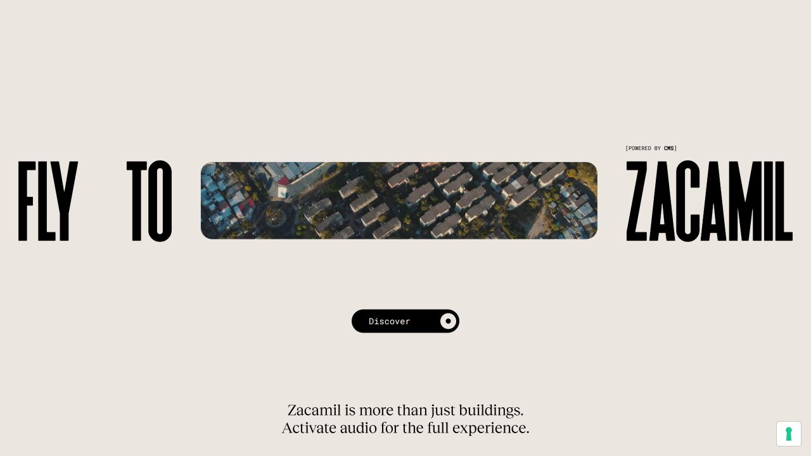

# 京师智行 1.20.0：关系数据与地图体验升级方案

日期：2026-10-08。最新状态：**用户已确认先执行数据两项，已形成1.20.0-data.1；UI延期，完整1.20.0未发布**。实际交付与限制见[数据阶段报告](data-1.20.0-stage.md)。

下文保留以1.15.0为基线制定的总体方案。方案不自动授权修改密钥、迁移数据库、公开发布或推送GitHub。

## 设计包导航（本轮继续细化）

以下规格编写于“继续完成计划设计”轮；后续仅数据阶段获准实施。已实现接口以数据阶段报告为准，UI与发布部分仍是草案：

1. [关系与接口契约](contract-1.20.0-relations.md)：稳定实体身份、菜单组、来源分层、快照分页、窗口级推荐与旧接口兼容。
2. [页面与美术规格](design-1.20.0-experience.md)：三种布局策略、状态导航、字体/颜色、面板尺寸、相机安全区、生成提示词。
3. [实施与验收矩阵](acceptance-1.20.0.md)：纵向样例先行、38项名录交叉检查、三轮使用任务、发布阻断与上传边界。

本轮进一步定位的风险：新窗口ID不能直接当旧POI打开；“换一家”不能排除整层；翻页不能混用新旧快照；真实推荐不能只排除simulated而放行inferred。导航需保存逐层返回状态，镜头需读取真实面板遮挡。

## 1. 本轮判断

当前问题不是缺一个更大的数据库或 Agent 框架，而是三处断层：

1. 菜单数据有楼层、来源和部分窗口线索，但公共详情接口把归属压平了。
2. 名录中的店铺有些缺真实点位，地图只显示可定位对象，用户因此认为记录丢了。
3. 建筑、店铺、对话仍以通用面板呈现，缺少“看哪栋楼—楼内有什么—选哪家—吃什么”的连续体验。

本版顺序固定为：**备份基线 → 整理关系 → 补资料 → 确定视觉目标 → 实现交互与美术 → 三轮实测 → 归档上传**。

不为录屏把未知事实藏掉，不把生成素材当作真实校园测绘；但可以有标注清楚的推测介绍、示意定位和创作模式。

## 2. 已证实的起点

详见 [数据审计](audit-1.20.0-data.md)。本次只读抽查得到：

| 对象 | 当前状态 | 对 1.20 的影响 |
|---|---|---|
| 合成目录 | 309 POI、296 Shop、560 Item；公开目录 308 POI | 计数包含不同来源，不等于 309 家已核实商户 |
| 新乐群三层 | 98 条真实转录条目仍在楼层供餐集合 | 应按已有菜单分组线索展示，不能凭菜名创造真实窗口 |
| 新乐群四层 | 248 条楼层集合条目，另 6 条淮南牛肉汤已独立关联 | 接口仍扁平合并，独立窗口也失去区分 |
| 时间表名录 | 38 条均在公开目录中 | 必须逐条验证搜索、分类、区域清单和地图入口 |
| 小吃街主排 | 13 条中 3 条可定位，10 条缺定位 | 要提供区域有序清单与明确精度，不让缺坐标对象消失 |
| 西侧组 | 6 条中 1 条参照餐厅可定位，其余 5 条只有参照关系 | “在西侧同一栋楼”与“已知道是哪一个模型 ID”分开 |
| 建筑目录 | 234 个记录，83 个有名称、151 个名称空白 | 模型体块不自动等于可核实的独立校内建筑；不能全部编成真实简介 |
| 建筑简介 | 当前为模板化位置说明 | 新增带来源的用途/服务/导览介绍，而不是替换楼名 |
| 代码归档 | 私有 GitHub 最新已提交为 v1.12.1，本机有未提交的 1.13–1.15 成果 | 先保护当前基线，不盲目 git add 全目录 |

## 3. 数据先行：关系结构

### 3.1 统一对象职责

```text
Campus / Area（校区或片区）
  └─ Building（物理建筑，可关联一个或多个模型网格）
       └─ Floor / Venue（楼层、楼层食堂等运营场所）
            └─ Shop / Window（真实商户或窗口）
                 └─ MenuItem → Variant / PriceObservation

所有实体与关系 → Evidence（来源、观察日期、获取日期、状态）
POI → 可被搜索和展示的入口，不强迫每种实体各有一套坐标
```

保留现有稳定 POI/Shop/Item ID。一个建筑有多家店；同品牌不同楼、不同楼层分别记录。默认点击科技楼显示科技楼，饮品模式才看到楼内瑞幸。楼层食堂不是一家拥有所有窗口的商户。

首选实现：在 `CatalogAdapter.snapshot()` 合并完成后，产生版本化只读关系视图（`projection_version: 1.20`）。保持原始 JSON 和旧 SQLite 不动；旧接口通过兼容适配器继续可用。对确有证据的归属修订先输出候选 diff，批准后以新版本映射发布，不覆写历史。

如果实施中必须改持久化 schema 或迁移历史数据，另列对象、数量、备份及回退方式，单独确认，不把“优化结构”解释成无限迁移授权。

### 3.2 关系必须有类型

| 关系 | 含义 | 不能混同 |
|---|---|---|
| contained_in | 窗口属于某楼层，楼层属于某建筑 | “在旁边”不是包含 |
| located_on_floor | 确认或候选楼层 | 建筑总层数不是店铺所在层 |
| west_of / near | 相对位置或参照 | 西北食堂西侧店铺不能挂到西北食堂里 |
| ordered_along | 同一分组内从北到南的顺序 | 不跨分隔组、跨楼层连成一条街 |
| serves / offers | 窗口提供菜单条目 | 同菜名不等于同窗口 |
| alias_of | 名称别名映射 | 同名分店不能合并 |

每条关系保留依据、状态和更新时间。包含关系检查循环；ID 引用检查孤儿；不同来源冲突不静默覆盖。

### 3.3 空间位置与展示锚点分开

- `location`：已有坐标及坐标系，用于可支持的距离计算，附精度/来源。
- `display_anchor`：楼栋代表点，仅用于高亮或展开楼内目录，不当作店门。
- `map_reference`：参照建筑或区域，显示“在这一片／西侧”，不显示“已定位店门”。
- `illustrative_anchor`：若确认采用创作模式，可沿示意街区排布的展示点；必须有“示意”样式，禁止进入真实步行时间计算。
- `unknown`：仍可搜索、看菜单、出现在区域清单，不能消失。

采用现有 EPSG:32650 原点，不重算整个校园，不用 AI 图修改真实轮廓、高度或道路。

## 4. 新三、新四及小吃街的专项修复

### 菜单流程

1. 以现有照片转录、`menu_section`、`source_file`、`shop_id` 生成逐组核对表。
2. 明确店招且来源支持的窗口，建立独立窗口映射；一张照片含邻店屏幕时逐区域判断，不能整个照片共享身份。
3. 无法确定窗口但能确定菜单组的，显示“菜单分组·窗口待核”，不计入真实窗口数。
4. 完全无归属的条目放“本层待归属”，不塞到任意窗口，不丢弃。
5. 公共详情增加 `menu_groups`，保留 `item_id/shop_id/group_id/floor`；分页在窗口内进行，分别显示窗口条数与当前加载数。
6. 新增/补齐“新三、新四、学三、学四、新乐群三层/四层”别名；支持搜索窗口名、菜单组与菜名，并返回完整面包屑。

示例：`新乐群 → 4F → 淮南牛肉汤 → 牛杂汤`。用户不应先翻整个食堂数百道菜才知道是哪家。

### 店铺可发现性流程

以时间表 38 条作为固定回归名录，保留用户提供顺序。每条输出：存在状态、别名、类别、区域、楼层、所属建筑/参照、位置精度、搜索结果、页面入口。

餐饮与饮品在“吃喝”中可一起浏览，在子分类中分开；便利店、眼镜、复印、美发等在对应分类，不以不属于餐厅为由丢弃。西侧乡村基、塔斯汀、鹏记、夜罐罐及库迪必须能从该区域入口找到。照片广告菜名不是新增店铺证据。

## 5. 建筑与区域资料补充

### 5.1 字段

每个可靠身份的建筑/区域准备：名称和别名、简短用途、主要服务、所属片区、已知楼层功能、访问限制、来源链接、发布日期、获取日期、冲突/未知说明。简介优先 50–120 字，细节折叠。

区分三类内容：

1. **官方或现场依据**：可进入正式介绍，字段级标来源。
2. **推测介绍**：依据楼名或周边关系概括，显示“推测，待核实”，不冒充官网原文。
3. **创作演示**：氛围文案、示意服务/菜单等，独立演示开关和身份；不能向正常推荐承诺真实价格、营业或可预约。

“为每栋楼整理资料”的验收是 234 个目录对象均有处理状态，不是编造 234 段确定介绍。先分类未命名体块、连接体、模型外/周边、可靠校园建筑，再查资料。

### 5.2 资料检索路径与当前证据

- [总务部餐饮服务](https://zwb.bnu.edu.cn/fwzn/jdfw/index.htm)：楼层类型与服务，不能把列举品类转换为逐个实名窗口。页面未明确更新日期时，不假定为当天事实。
- [2026-08-31 场馆楼宇提质改造](https://news.bnu.edu.cn/zx/zhxw/8ceb3e43dacf4389ba3f9ef81736b923.htm)：可支持邱季端体育馆的教学、锻炼、文体活动和科研办公等功能描述。这里仅为候选来源，尚未录入应用。
- [2022 年统计学院校园云游](https://stat.bnu.edu.cn/xsgz/xwdt/247418.htm)：可提供校园区域与地标线索，旧营业/服务状态必须复核。
- [2023-03-27 游泳馆修缮报道](https://news.bnu.edu.cn/zx/zhxw/e6b4e541255e4b198c5244352e94f41d.htm)：可支持游泳馆位于主馆地下一层及教学服务用途，不据此声称当前正在开放。
- 学院“联系我们”、图书馆服务指南、教务教学场所资料：按已确认身份逐栋查找，不将昌平/珠海同名楼误配海淀。
- 用户此前微信链接：正文无法读取则保留待提供，不把搜索摘要当完整原文；已有截图可做独立证据。

实施时使用浏览器打开实际页面，记录 URL 和可读段落，摘要改写而非全文转载。此次网络检索可读，但浏览器控制出现长时间超时，未声称已完成逐栋浏览核验。

## 6. 美术与交互方向：京师微缩漫游

不是再微调上一版绿色卡片。提议采用**全屏校园微缩场景 + 深墨色导航浮条 + 暖瓷白内容卡 + 稀疏银杏金点缀**。地图承担主视觉，文字承担判断依据。

### 6.1 参考拆解与证据范围

- [Colonia Zacamil](https://coloniazacamil.com/)：本轮成功取得入口截图。强烈窄体展示字、大片留白、长条场景窗口与单一黑色操作按钮，层级比同权重胶囊堆叠清楚。其地图内多角度/热点状态尚未成功截图；不能据入口截图声称验证了动画实现。
- [Apple Maps](https://www.apple.com/maps/)：官方介绍强调地点卡里的地址、时间、网站等信息及分类探索。采用其信息层级思路，不复制商标/字体/地图资产，不将官网营销页当作已测试原生应用。
- [Earth Studio Camera Target](https://earth.google.com/studio/docs/advanced-features/camera-target/)：借鉴围绕明确目标组织相机和过渡，Three.js 自己实现，不把 Earth Studio 当嵌入组件或定位服务。

当前唯一接受的本轮参考截图（入口，不是升级成品）：



### 6.2 具体结构变化

| 状态 | 地图与内容组织 |
|---|---|
| 初次进入 | 镜头明确对准校园核心；片区名与轻量操作提示；可跳过短入场，不设置强制观看片头 |
| 自由探索 | 顶部中央单一搜索/询问入口；一条紧凑分类导航；底部片区导览与指南针；不常驻长文字空面板 |
| 点击建筑 | 建筑高亮，短地点卡展示楼名/用途/楼层入口；深层资料按需打开 |
| 吃喝探索 | 区域店铺与可定位热点一起出现；建筑聚合标数量，点击先选楼层再选窗口 |
| 窗口菜单 | 清楚的楼栋—楼层—窗口路径；图文菜单按组，真实图片与示意样品分别标识 |
| 询问助手 | 输入框平滑转为对话工作区；回答卡与地图共享选中对象；定位不关闭回答、不丢阅读位置 |
| 录屏导览 | 用户主动点“导览”后按核心区/新乐群/小吃街/体育区展示；可暂停、跳转，手动拖动立即接管 |
| 手机 | 单一底部面板收起/摘要/展开三状态；输入框和返回可达；不同时堆叠菜单、详情、对话 |

卡片不再为所有实体共用餐饮模板；建筑、区域、窗口、公共服务分别有对应信息。修正“更多卡片=更成熟”的倾向，首屏只留主操作。

### 6.3 字体、花纹和素材

- 正文采用可读中文无衬线，展示标题用有识别度的中文宋体/衬线；不用窄拉伸中文模仿英文展示字。许可与本地回退一起检查。
- 字级按职责统一：片区标题、实体标题、正文、辅助、数字价格；不使用满屏大写英文标签和无意义 AI 标语。
- 银杏/校园线描仅在边缘或留白；正文、菜单、地图目标附近保持清晰。使用现有素材或独立生成的可复用图层。
- ImageGen 生成概念目标与独立纹理/花纹，不生成整张图替代工作地图；模型标为手绘示意材质，不杜撰可导航建筑。
- 生成图像工具本身不是视频模型。交互动画由 Three.js/CSS/WAAPI 驱动才能随用户即时响应；若另需生成式片头视频，先确认可用视频工具与外部服务，不承诺当前已经生成。

### 6.4 供概念与素材生成使用的提示词草案

概念图需在实际参考地图截图恢复后附图生成；也可由用户明确同意先使用已保存的Colonia入口图与1.15真实页面图。当前已询问替代方案，未收到选择前不以本段文字替代缺失参考。

> 京师智行校园生活应用，地图主导的精致微缩校园体验。保留输入截图里的校园布局、真实建筑轮廓与道路；深墨绿近黑色的紧凑导航浮条，暖瓷白的轻盈地点卡，银杏金仅作极少量状态强调。三维场景具有克制的手绘纸感、温暖自然光和明确的道路层次。中文标题与正文有清楚层级，按钮数量少，真实菜单按建筑、楼层、窗口分组。视觉要像可长期使用的校园地图产品，不像后台仪表盘或聊天机器人模板。地图中选中建筑是视觉中心，面板不盖住目标。装饰花纹只在页边留白。展示自由探索、地点详情、窗口菜单、对话四种状态的同一设计系统。无巨幅口号、无霓虹渐变、无泛滥玻璃卡片、无假校园几何、无整屏图片充当可交互地图。

独立素材提示：

> 为暖白与深墨绿校园地图界面制作稀疏银杏纸艺边饰，扁平透明背景，叶脉细致但低对比，仅沿上角/侧边分布，中心留空，无文字无地图无标志；画面密度适合 300–500 像素宽卡片的边缘，作为轻微视差的独立图层，不遮挡信息。

### 6.5 动效与性能约束

- 指针反馈约 100–160ms；面板 180–280ms；镜头按距离约 600–1000ms，均须可中断。
- 不只改变相机位置，同时计算目标、俯角、距离与实际面板遮挡安全区，避免目标被浮层盖住或镜头翻转。
- 切换建筑与楼层有位置连续性；模型回复不能无请求抢镜头。
- 背景微动仅在主动导览/探索时低频出现，阅读、输入、后台、减少动态时停止。
- 动效规范优先 transform/opacity，禁用 transition:all 和核心布局动画；键盘操作不强制动画。
- 全屏动态纹理、模糊和大透明层可能降低录屏帧率；先测后定，不把加特效数量当作美术质量。

## 7. 模块边界与执行阶段

现有 Python + JSON + Three.js 保留，不为 UI 大改引入全套框架。

| 阶段 | 文件/目录职责 | 完成门槛 |
|---|---|---|
| A 基线与盘点 | releases/ 本机存档；docs/ 明确清单与校验 | 当前可用版本可复原，私有数据不进入代码包 |
| B 关系视图 | backend/ 新增关系投影和校验；tests/ 隔离样例；私有映射位于 data/life/ 版本目录 | 稳定 ID、无孤儿/循环、字段来源可追溯、38 条逐项覆盖 |
| C 菜单与简介 | tools 的分组 DTO、搜索别名、窗口入口；官方来源适配 | 新三/新四按组展示；未知归属明确；每个建筑有处理状态 |
| D 视觉目标 | docs/ 对照截图、目标图、提示词；art/ 独立素材与许可清单 | 已取得足够参考或用户确认替代参考；选定视觉目标，补齐手机/异常状态；不宣称缺失视角已审阅 |
| E 前端实现 | app/explore/ 分离关系目录、详情、对话、镜头与动效；保留账号模块 | 地图主导且可操作；窗口/区域/建筑卡各有职责；全部功能可达 |
| F 三轮实测 | docs/ 每轮截图和问题；tests/ 契约/行为/安全/打包回归 | 每轮有“发现—修复—复测”，不能复用旧截图称新一轮 |
| G 1.20 归档 | VERSION、CHANGELOG、学习文档、运行包、manifest；批准后 Git 分支/标签 | 版本/入口一致，验收和限制齐全，上传清单审查完成 |

新增目录/模块实施前在 CLAUDE.md 写具体约定，不以本方案预先创建空架构。

## 8. 作为使用者的三轮验收

### 第一轮：把东西找到

从首页找新三/新四；进入某个窗口再找菜；逐条搜索小吃街时间表；西侧同楼商户逐一打开；点击科技楼看用途，再切饮品找瑞幸；返回不丢状态。

输出实体—接口—UI 交叉覆盖矩阵。无坐标的条目必须能找到并理解位置范围。

### 第二轮：完整任务与异常

20 元吃辣、15 元以内、不吃米饭、35 分钟后上课、无候选；甜点不能冒充正餐。对话追问、取消、重试、历史、偏好、地图联动逐项使用。

登录、首次改密、A/B 隔离、删除/重置等在隔离测试身份/目录验证，不动队友真实账号和聊天。模型未配置、超时、断网、额度、资源加载失败有可恢复状态。

真实模型测试与假模型测试分别记录；有当前有效进程密钥后做小样本真实请求，记录用量/耗时，不回读聊天里旧密钥，不写 .env。

### 第三轮：录屏与设备

桌面 1440×900、1920×1080；手机 390×844、低高度；键盘和减少动态；快速切换、长菜单、末尾分页。真实手机软键盘未实测则单列，不用模拟视口冒充。

相同视口/目标比较升级前后；全景、俯视、食堂近景、菜单、对话都有截图。性能记录首次/缓存加载、交互卡顿和录屏表现，不无依据承诺 60fps。

原有项目语法、Python/API、Node 与安全检查均重跑。数据关系、菜单保真、别名、示意位置不进测距、许可文件打包新增回归。

## 9. 保存与 GitHub 方案（需要明确确认）

已只读确认现有远程为私有仓库 `guoyukun61-droid/bnu-campus-3d`，当前分支 main，最近提交 v1.12.1。建议：

1. 先本机保存当前 1.15.0 源代码基线与校验清单；业务数据独立私有备份。先审查现有未提交改动来源。
2. 从当前工作状态建立 `release/1.20.0`，保留已有更改，不 reset/rebase、不强推。
3. 按基线、关系修复、内容、UI、验收小提交；完成后标签 `v1.20.0`。不覆盖旧标签。
4. 首次推送前再次出明确文件清单/安全扫描摘要。仅推送批准的代码、测试、文档、许可和可分发素材，保持仓库私有，不开启 Pages/生产部署。
5. `data/`、账号/聊天、原始照片、.env、token、运行日志、原始遥感影像不上传。
6. 将安全业务目录快照作为独立可选项：若未批准上传，仅提供模拟样例复现，不会声称 GitHub 包已含真实完整数据库。
7. 运行包只含实际依赖与当前安全模型；源工程包与运行包分开。当前脚本漏掉无扩展名的 `vendor/three/LICENSE`，须修复并验证。
8. HTTP 模型脱敏不代表归档中的原 GLB/Blend 已脱敏；逐项检查元数据。第三方截图仅本地研究，不默认上传到可分发产品。

## 10. 本轮已做与未做

已做：规则补充、只读数据与代码审计、GitHub 私有性查询、官方网页文本检索、Colonia 入口截图取得并打开检查、方案与学习总结；继续设计轮补齐关系接口契约、状态/动效/安全区规格、三轮验收矩阵及三个布局方向。

未做：数据/接口修复、逐栋简介录入、1.20 UI 实现、生成新素材/视频、多角度参考截图、全功能实测、版本号修改、代码打包、commit/push/tag/Release。浏览器控制连续超时，未将其当成应用本身报错。

**下一步**：先选择可用的视觉参考与布局方向，再确认实施范围。GitHub推送待验收后出具体文件清单单独确认；不将视觉选择、实施和上传合成一次含糊批准。
